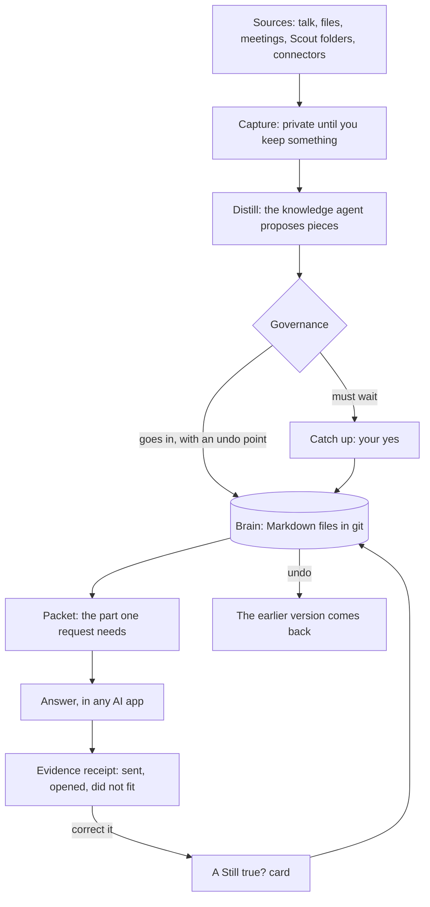
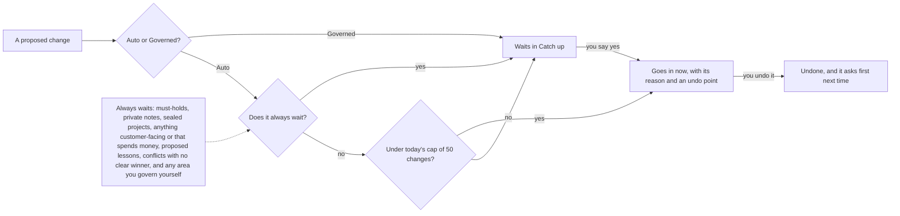
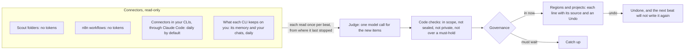
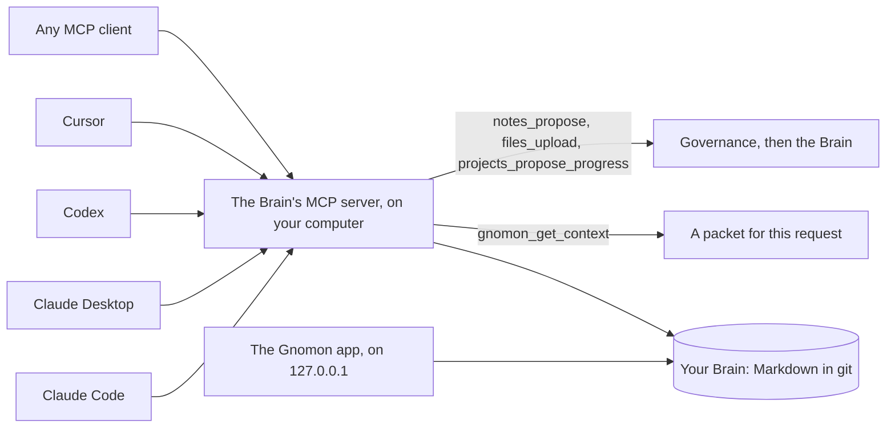

# Contxt

**One Brain of long-term context for every AI you use, kept on your own computer.**
It learns from what you bring in, keeps itself current, and shows you every change with an undo.

The redesigned app calls itself **Gnomon**: the same product, the same `contxt` command.

> Pre-release. Source-available under the [PolyForm Shield License 1.0.0](LICENSE): use it and
> change it freely, but not to compete with it. See [LICENSING.md](LICENSING.md).

## Screenshots

Every screenshot comes from `knowledge-company`, a made-up demo Brain. Brightmill, its people
and its numbers are invented.

**Home.** Your Brain keeps itself. The heartbeat bar says when it last read your sources and
what it changed. Anything that must wait for you sits right below.


**What the heartbeat did, and why.** Each region of the Brain shows the lines the last beats
wrote, where each came from, and an Undo.


**Ask.** The answer comes from your Brain alone, cites the notes it used, and opens an evidence
receipt: what was sent, what the AI opened after, and what did not fit.


<table>
<tr>
<td width="50%"><b>Capture.</b> Paste, upload, record, or let Scout watch a folder. It stays private until you keep something.<br></td>
<td width="50%"><b>Distill.</b> Each sentence of a capture becomes a proposed piece, and the thread shows where on your Brain it would land.<br></td>
</tr>
<tr>
<td><b>Brain.</b> What your AI knows, in the words it receives, mapped onto regions like the parts of a real brain.<br></td>
<td><b>Catch up.</b> What needs your yes, grouped so the safe ones go in together. What went in on its own is under What changed.<br></td>
</tr>
<tr>
<td><b>A note.</b> When it is sent, exactly what your AI receives, where it came from, and its versions.<br></td>
<td><b>A project's Tasks.</b> Give an orchestrator a goal. It spawns agents through your CLIs and fills its own sheet.<br></td>
</tr>
<tr>
<td><b>A project's Outputs.</b> What AI work made, with its sources and the trail that led to it. Outputs never change the Brain on their own.<br></td>
<td><b>Agents.</b> Your knowledge agent: which CLI it runs on, what it can do, and where data goes.<br></td>
</tr>
<tr>
<td><b>Activity.</b> Every request from every AI app, what it got, and every change with its undo.<br></td>
<td><b>Settings, Approval.</b> The heartbeat's pace, the connectors it reads, and n8n on this computer.<br></td>
</tr>
</table>

## How it works

### From a source to an answer, and back

What you bring in waits in Capture, private. Your knowledge agent distills it into small
pieces. Governance decides which go straight in and which wait for you. Each AI request then
gets a packet: only the part of the Brain it needs. The answer comes with a receipt, and a
wrong answer can be corrected from that receipt. Every change can be undone.



### Governance: Auto or Governed

New Brains start in **Auto**: your AI keeps the Brain itself, and every change it makes is an
undo point with its reason. In **Governed**, every suggestion waits in Catch up. Some things
always wait, in either mode.



**Settings, Approval and auto-governance** switches between the two, pauses Auto, sets the
daily cap, and adds standing permissions: let in this kind of piece, from this place, in this
area. In Governed, a preset (Personal, Careful, Regulated) says what waits.


### The heartbeat

The heartbeat keeps the Brain current on its own. Every 5, 15, 30 or 60 minutes, outside your
quiet hours, it reads what changed in each connector you turned on, read-only. One model call
then judges the new items: which region and project each belongs to, and what it updates.
Code checks every write before it is made. Each write is an undo point, and a line you undo is
never written again.

The first beat can onboard you. Each CLI on this computer (Claude Code, Codex, Gemini CLI)
reads what it keeps on you: its memory files, what you said in its chats, and what it remembers
from its own other apps (Claude Code from Claude, Codex from ChatGPT, Gemini CLI from Gemini).
It turns that into context packets, which the judge files like any other read. After that, each
reads only what is new, once a day by default, and you can tell each what to look for. Gnomon
gathers those files itself, read-only, and never opens a CLI's sign-in.



A beat never sends, posts, replies or spends. On the demo Brain, a beat that changed something
used about 4,000 tokens on the Claude Code plan. Reads through **n8n** cost no tokens: a
workflow on your computer reads an app with the sign-ins you gave n8n and posts what changed to
Gnomon. Code checks that every step of such a workflow only reads.
What each kind of work costs, and a typical day: [docs/costs.md](docs/costs.md).

### One Brain, every AI

Your AI apps reach the Brain over MCP, through a small local command beside your Brain folder.
No account and no token. Every chat in every connected app reads and writes the same Brain.



Each chat starts by asking the Brain for the context its request needs (`gnomon_get_context`).
When you state a lasting rule, a preference, a decision or a change in a project, the AI
proposes it back. The app's own AI work (distilling, Ask, the heartbeat, orchestrators) runs
through a CLI on this computer, Claude Code by default, on your own plan. See
[MCP](docs/mcp.md) and [Running the app's AI work](docs/runners.md).

## Get started

### 1. What you need

- [git](https://git-scm.com/) and [uv](https://docs.astral.sh/uv/), which brings its own Python.
  To install uv:
  - macOS and Linux: `curl -LsSf https://astral.sh/uv/install.sh | sh`
  - Windows (PowerShell): `powershell -ExecutionPolicy ByPass -c "irm https://astral.sh/uv/install.ps1 | iex"`
- [Claude Code](https://claude.com/claude-code), installed and signed in, for the app's own AI
  work: distilling, Ask, the heartbeat and orchestrators.
- [Node.js](https://nodejs.org/) only to build the web app yourself (20.19 or newer) or to host
  n8n here (20.19 to 24).

### 2. Install

```bash
git clone https://github.com/rami-guzlan/Gnomon-Brain.git
cd Contxt
uv sync
uv run contxt web --download
```

`web --download` fetches this version's built web app and checks it. To build it yourself
instead: `npm install`, then `npm run build`.

On Windows, if `uv sync` stops with "Failed to update Windows PE resources", antivirus is
scanning a launcher uv just wrote. Run it again: each try gets further.

### 3. Choose a starter

```bash
uv run contxt starters
uv run contxt setup --brain empty
```

`empty` starts your own Brain. The four demos are made-up people and companies, good for
looking around first:

| Demo | Who it is for |
| --- | --- |
| `knowledge-company` | Brightmill, a made-up knowledge company, as its one-person marketing team runs it: voice and approval rules, audience research, a webinar series, a podcast, content skills |
| `programmer` | Kai, a made-up backend engineer: machine and stack, code style and git rules, services and deploys, an open source release |
| `entrepreneur` | Riley, a made-up founder: a seed-stage startup and its numbers, a seed round, a past company's lessons, angel checks |
| `personal` | Taylor, a made-up parent: family schedules and an allergy, the house, the budget, training, a trip to Japan |

To try one without touching your own Brain: `uv run contxt demo knowledge-company`. It runs
from its own folder on its own port. See [brains/README.md](brains/README.md).

Setup never overwrites a Brain that is already there. It fetches, once, a small model that
matches requests by meaning (about 70 MB). `--offline` downloads nothing, and the Brain then
matches by words. Then see that everything works, and start the app:

```bash
uv run contxt check
uv run contxt serve
```

`check` names the fix for anything missing. `serve` starts the app on `http://127.0.0.1:8787`
and prints your sign-in link. That link is your key: keep it to yourself.
`uv run contxt token` prints it again.

Home opens on a short quick start: connect your AI, capture one source, review what it found,
ask a question, and inspect the evidence.


### 4. Connect an AI app

```bash
uv run contxt connect claude-code
```

prints one command. Run it once, and every Claude Code session has your Brain. The same works
for `claude-desktop`, `codex`, `cursor` and `other`. **Settings, Your AI apps** shows the same,
with your paths filled in.


### 5. Ask the Brain first

A model reads your Brain only when it asks, and it forgets most often on a follow-up.
`contxt connect` also prints one instruction for that app's own instructions (for Claude Code,
`~/.claude/CLAUDE.md`). With it, the model asks the Brain before every answer. In the app,
**Agents, Knowledge agent, Ask the Brain first** adds it for you, with one switch per app.

### 6. Your first capture

Open **Capture** and paste a few lines: notes from a call, an email, a decision. Or upload a
file, record a meeting, or use **Tell it** on Home. Open what you saved and choose **Distill
into context**: your knowledge agent reads it and proposes the pieces worth keeping. **On your
Brain** shows where each would land.

Talk and recordings turn into text on this computer with the speech model (about 480 MB, once):
`uv run contxt models --download`.

### 7. Catch up

**Brain, Catch up** lists what waits for you: safe pieces you can keep together, and the few
that need a real decision. **What changed** lists what went in on its own, each with Undo. In
Auto, most days take a minute.

### 8. Turn the heartbeat on

1. In **Capture, Scout your folders**, choose a folder and the project it feeds.
2. In **Settings, Approval and auto-governance, Heartbeat**, choose how often it beats and your
   quiet hours.
3. In **Start with what your AI apps already know**, choose the AI apps to read and press
   **Build my Brain from them**. For an app none of them can read, copy the question it shows,
   ask that app, and paste its answer under **Add memory from another AI app**.
4. Press **Find connectors in my CLIs**. It lists the MCP servers your CLIs already use and
   keeps only their read-only tools. Connectors that read your own accounts start off: turn on
   the ones you want.
5. Press **Beat now** on Home to see the next beat.

### 9. Host n8n (optional)

In the same Heartbeat card, **Host n8n here** installs n8n on this computer, inside Contxt's
data folder, listening on `127.0.0.1` only. **Open n8n** and sign in to your apps there:
Gnomon never sees those sign-ins. **Suggest workflows** offers a read-only workflow for each
app it found. Turn each one on in the Heartbeat card. From then on, reading those apps costs no
tokens.

### 10. Where to go next

- **Projects**: open one, see what your AI gets for it, and give an orchestrator a goal in
  **Tasks**. What it makes lands in **Outputs**.
- **Agents**: the knowledge agent, agent profiles, skills and alignment.
- **Activity**: every request, what it got, and every change.
- **Settings, Test the Brain**: run the Brain's own tests. See [Test the Brain](docs/test-the-brain.md).
- **Settings, Backups**: keep a copy. See [Operations](docs/operations.md).

The full walkthrough, with Docker and what to do when something goes wrong, is in
[docs/setup.md](docs/setup.md).

## Where your things live

| Folder | What it holds | In this repository? |
| --- | --- | --- |
| `brain/` | Your Brain: notes, skills, references, projects, as Markdown | No: a git repository of its own, which you can push to a private remote for backup |
| `data/` | The app's database, uploaded files, your sign-in key, backups | No |
| `outputs/` | What your AI makes through the app | No |
| `.env` | This folder's settings | No |

The Brain is files, and the app's bookkeeping is a small SQLite database, on purpose: files
are what every AI tool and editor can read, with a history you can undo, while the app's live
state (captures waiting, AI work in progress, sign-in keys) needs a database that stays
consistent when several things change at once. What is worth keeping moves from the app into
the Brain.

Everything runs on `127.0.0.1`. Matching by meaning and speech to text run on local models.
What leaves your computer is what your AI apps, and the CLI you chose for the app's AI work,
send to their own model.

## Documentation

- [Setup](docs/setup.md): install, your Brain, connecting your AI apps, Docker, troubleshooting
- [Architecture](docs/architecture.md) and [decisions](docs/adr/)
- [MCP](docs/mcp.md): the Brain's server and the app's endpoint
- [Running the app's AI work](docs/runners.md)
- [Operations](docs/operations.md): backups, upgrades, the private-server profile
- [Test the Brain](docs/test-the-brain.md)
- [The Brain](docs/brain/ARCHITECTURE.md): [routing](docs/brain/ROUTING.md),
  [governance](docs/brain/GOVERNANCE.md), [capture](docs/brain/CAPTURE.md),
  [configuration](docs/brain/CONFIG.md), [the supply chain](docs/brain/SUPPLY_CHAIN.md)
- [Evaluations](docs/evals/): how well the Brain finds what a request needs

## Repository

```
apps/server          the app's API, its MCP endpoint, the worker, the heartbeat and the contxt command
apps/web             the web app
packages/core        application services behind one facade
packages/brain       the Brain engine: routing, governance, files, its MCP server
packages/connectors  how each AI app connects
brains/              starter Brains: empty and four demos
docs/                setup, architecture, MCP, operations, decisions, the Brain's design
```

For AI coding agents working in this repository: [AGENTS.md](AGENTS.md).

## Development

```bash
uv run pytest
uv run ruff check .
uv run mypy
npm test
npm run typecheck
```

See [CONTRIBUTING.md](CONTRIBUTING.md). Security reports: [SECURITY.md](SECURITY.md).

## License

Copyright 2026 Rami Guzlan. Source-available under the
[PolyForm Shield License 1.0.0](LICENSE): you may use, change and share Contxt for any purpose
except competing with it. [LICENSING.md](LICENSING.md) says what that means in plain words.
